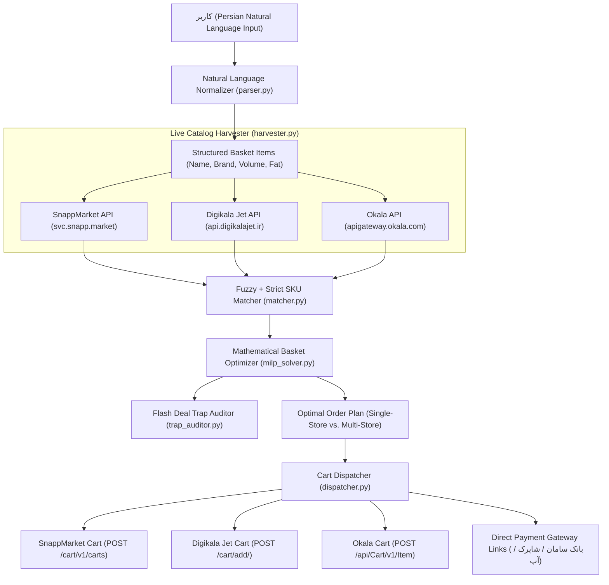

# سبد (Sabad) — Production-Grade Cross-Store Grocery Optimizer & Cart Dispatcher

**سبد (Sabad)** is an intelligent, live cross-store grocery optimizer and automated cart dispatcher for Iranian quick-commerce platforms: **SnappMarket (اسنپ‌مارکت)**, **Digikala Jet (دیجی‌کالا جت)**, and **Okala (افق کوروش / اکالا)**.

Sabad operates on **100% live networks** without mock stubs or synthetic databases. It parses Persian natural language grocery lists, queries real store catalogs concurrently, runs a mathematical optimization model (MILP / Branch-and-Bound), audits **"تله‌های شگفت‌انگیز" (Flash Deal Marketing Traps)**, and directly executes authenticated Add-to-Cart mutations with instant payment gateway handoffs.

> نکته‌ی ساختاری: این مخزن یک پروژه‌ی واحد است. `app.py` رابط Streamlit، `streamlit_app.py` ورودی استاندارد جایگزین و `sabad/` پکیج منطق کسب‌وکار است؛ پوشه‌ی دوم یا نسخه‌ی داپلیکیت از پروژه وجود ندارد.

---

## 📚 Spec-Oriented Development (SOD) — Single Source of Truth

Sabad is built following the **Spec-Oriented Development (SOD)** paradigm. Complete architectural specifications, API contracts, currency normalization rules, and mathematical formulations are strictly documented in [`specs/`](specs/):

- 🏛️ [**Spec 01: System Architecture & Dataflow**](specs/01-architecture-and-dataflow.md)
- 📦 [**Spec 02: Data Models & Domain Contracts**](specs/02-data-models-and-contracts.md)
- 🔌 [**Spec 03: Store Adapters & Live API Contracts**](specs/03-store-adapters-api.md) *(Includes critical Toman vs Rial rules)*
- 🔍 [**Spec 04: Persian NLP & Strict SKU Matcher**](specs/04-nlp-and-sku-matching.md) *(Regex boundaries, volume & flavor guards)*
- 🧮 [**Spec 05: Mathematical Optimization & Marketing Trap Auditor**](specs/05-optimization-engine.md) *(MILP formulation)*
- 🖥️ [**Spec 06: UI Architecture & Calculation Transparency**](specs/06-ui-and-transparency.md) *(4-Tab 9-column audit views)*
- 🧪 [**Spec 07: Testing Strategy & Cloud Deployment**](specs/07-testing-and-deployment.md) *(198 pytest tests & Streamlit Cloud)*

---

## 🏛️ System Architecture



---

## ⚡ Core Modules

### 1. Session & Auth Manager (`sabad/adapters/session_manager.py`)
- Manages persistent phone-number OTP authentication across runs.
- Stores encrypted session tokens/JWTs in `.sessions/` directory.
- Re-uses valid sessions automatically.

### 2. Live Flash Deal & Catalog Harvester (`sabad/harvester.py`)
- Employs `asyncio.gather` for non-blocking concurrent requests across all 3 platforms.
- Dynamically resolves the nearest serving branch/dark-store based on geolocation (`latitude`, `longitude`).
- Extracts live tiered shipping policies and Minimum Order Values (MOV).
- Identifies active daily flash deals (*تخفیف‌های کهکشانی / شگفت‌انگیز*).

### 3. Persian Natural Language Normalizer (`sabad/normalizer/`)
- **Digit Normalization (`persian_digits.py`):** Converts Eastern-Arabic (`٠-٩`) and Persian-Urdu (`۰-۹`) numerals into standard ASCII digits.
- **Specification Parser (`parser.py`):** Uses volume-first regex precedence to extract:
  - Multipliers / Quantities (`دو تا`, `۳ عدد`, `یه دونه`)
  - Volumes & Weights (`۱ لیتری`, `۳۵۰ گرمی`, `۴ کیلوگرمی`)
  - Fat percentages (`پرچرب`, `کم‌چرب`, `۱.۵٪`)
  - Target Brand (`کاله`, `پریل`, `میهن`, `دامداران`)
- **SKU Matcher (`matcher.py`):** Combines RapidFuzz token-set similarity with strict physical attribute filters to eliminate invalid volume/fat mismatches.

### 4. Mathematical Basket Optimizer & Trap Auditor (`sabad/optimizer/`)
- **Branch-and-Bound Combinatorial Solver (`milp_solver.py`):** Minimizes total customer cost:
  $$\text{Min} \sum_{s \in S} \left( \sum_{i \in I} \text{Price}(i, s) \cdot q_i \cdot x_{i,s} + \text{DeliveryFee}_s(\text{Subtotal}_s) \right) + \text{SplitPenalty} \cdot (|S_{\text{active}}| - 1)$$
- **Flash Deal Trap Auditor (`trap_auditor.py`):** Mathematically audits loss-leader promotions:
  $$\text{NetAdvantage} = \Delta_{\text{deal}} - (\Delta_{\text{collateral\_markup}} + \Delta_{\text{extra\_shipping}})$$
  Flags **CRITICAL TRAP** if buying the discounted item at Store X results in a net-loss due to marked-up collateral items or extra delivery fees.

### 5. Cart Dispatcher & Payment Gateway Handoff (`sabad/dispatcher/`)
- Concurrent authenticated mutations (`POST /cart/add`) to populate the user's remote carts.
- Generates deep links and web checkout URLs (`https://snapp.market/checkout`, `https://www.digikalajet.com/cart`, `https://okala.com/cart`) directing the user directly to the final payment stage.

---

## 🚀 Quickstart & Setup

### Prerequisites
- Python 3.10+
- macOS, Linux, or Windows

### 1. Installation
Clone the repository and set up a virtual environment:
```bash
git clone https://github.com/your-username/Sabad.git
cd Sabad

python3 -m venv .venv
source .venv/bin/activate

pip install -e .
```

### 2. Environment Configuration
Copy `.env.example` to `.env`:
```bash
cp .env.example .env
```
Customize coordinates and credentials in `.env`:
```ini
LATITUDE=35.715298
LONGITUDE=51.404343
SNAPP_MARKET_PHONE=09120000000
DIGIKALA_JET_PHONE=09120000000
OKALA_PHONE=09120000000
DEFAULT_SPLIT_PENALTY_TOMANS=25000
```

---

## 🖥️ Running the Streamlit Web Application

Launch the interactive web UI with full Persian RTL typography:
```bash
streamlit run app.py
```
Open your browser at `http://localhost:8501`.

### تجربه‌ی جدید کاربر

- کاربر می‌تواند فهرست خرید را با متن فارسی یا ضبط صدای کوتاه وارد کند. تبدیل صدا به متن با Gemini اختیاری است و در صورت نبودن کلید، ورود متنی همچنان کار می‌کند.
- نتیجه‌ها بر اساس قیمت کالا، تخفیف واقعی، موجودی، حداقل مبلغ سفارش و هزینه‌ی ارسال مقایسه می‌شوند؛ «سبد ترکیبی» فقط وقتی پیشنهاد می‌شود که جریمه‌ی ارسال‌های جداگانه را هم پوشش دهد.
- جست‌وجوی کالا برای هر فروشگاه با نام اصلی، عبارت خام کاربر و در صورت نیاز عبارت‌های جایگزین (مثل «پاستا» برای «ماکارونی») انجام می‌شود. اگر حجم یا وزن گفته نشده باشد، فروشگاه به‌خاطر تفاوت اندازه‌ی بسته حذف نمی‌شود؛ جزئیات عبارت‌ها، تعداد نتایج خام و دلیل رد هر نتیجه در گزارش همان فروشگاه قابل مشاهده است.
- ورود حساب از OIDC پشتیبانی می‌شود و نشست فروشگاه‌ها در فضای هر کاربر Streamlit نگه‌داری می‌شود تا بین کاربران نشت نکند.

### ورود امن در محیط عمومی

فایل نمونه‌ی `.streamlit/secrets.example.toml` را به `.streamlit/secrets.toml` کپی کنید و مقادیر OIDC را تنظیم کنید. برای Google، `server_metadata_url` همان آدرس نمونه است و `redirect_uri` باید با دامنه‌ی واقعی برابر باشد و به `/oauth2callback` ختم شود. فایل secrets در git نادیده گرفته شده است. در Vercel همین مقادیر را با نام‌های `OIDC_REDIRECT_URI`، `OIDC_COOKIE_SECRET`، `OIDC_CLIENT_ID`، `OIDC_CLIENT_SECRET` و `OIDC_SERVER_METADATA_URL` ثبت کنید؛ wrapper آن‌ها را بدون نوشتن روی دیسک به Streamlit می‌دهد.

### استقرار

برای اجرای پایدار Streamlit، **Streamlit Community Cloud، Railway، Render یا Fly.io** انتخاب مناسب‌تری هستند چون اتصال WebSocket را نگه می‌دارند. این مخزن یک wrapper رسمی `asgi_app.py` و یک handler در `api/index.py` دارد و `vercel.json` را برای استقرار Vercel آماده می‌کند؛ اگر Vercel برای پلن شما WebSocket طولانی را محدود کند، همان image را روی یکی از سرویس‌های بالا اجرا کنید و دامنه را به آن متصل کنید. در هر دو حالت، `GEMINI_API_KEY`، `GEMINI_MODEL` و مقادیر `[auth]` را فقط به‌صورت secret محیطی تنظیم کنید.

### Key UI Features:
1. **Connection Status Indicators:** Real-time session status for SnappMarket, Digikala Jet, and Okala.
2. **Preset Location Selector:** Fast switching between Tehran delivery zones (Yousef Abad, Saadat Abad, Tajrish, Tehranpars).
3. **Persian Text Input & Prepared Baskets:** Free-form Persian text or quick-select daily grocery presets.
4. **Interactive Trap Audit Report:** Visual breakdown of flash deal savings vs collateral item markups.
5. **Multi-Store Comparison Table:** Side-by-side comparison of individual stores vs. the optimal hybrid basket.
6. **Direct Cart Dispatch:** One-click automated population of carts across winning stores.

---

## 🧪 Testing & Verification

### Running the Test Suite
Sabad includes a 4-Tier comprehensive test suite:
```bash
pytest -v
```
- **Tier 1 (Feature Coverage):** End-to-end pipeline from Persian string to payment handoffs.
- **Tier 2 (Boundary & Corner Cases):** Single-item baskets, missing inventory, and MOV thresholds.
- **Tier 3 (Combinatorial Pairwise):** Delivery fee variance and optimal store selection.
- **Tier 4 (Real-World Scenarios):** Severe marketing traps and multi-store split optimization.

### Verifying Live Store Endpoints
To verify live connectivity against Iranian quick-commerce servers:
```bash
python tests/verify_live_endpoints.py
```

---

## 📄 License
MIT License. Developed for automated grocery optimization and consumer protection.
