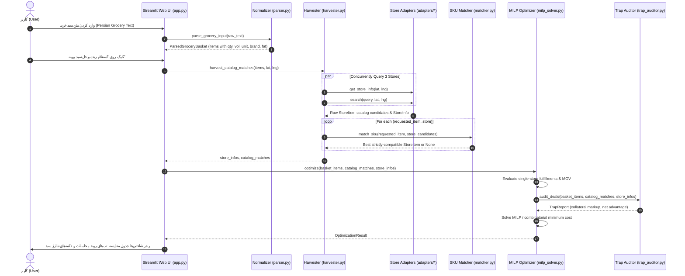

# Spec 01: System Architecture & Dataflow

> **Status**: Approved & Verified  
> **Package**: `sabad/`  
> **Entrypoints**: `app.py`, `streamlit_app.py`

---

## 1. System Overview

**Sabad (سبد)** is an autonomous, real-time cross-store grocery optimizer and automated cart dispatcher for Iranian quick-commerce supermarkets:
- **SnappMarket (اسنپ‌مارکت / هایپراستار)**
- **Digikala Jet (دیجی‌کالا جت)**
- **Okala / Ofogh Koorosh (افق کوروش / اکالا)**

Sabad queries live supermarket APIs based on the user's geographic coordinates (`lat`, `lng`), extracts product candidates, validates physical attributes, solves a Mixed-Integer Linear Programming (MILP) cost-minimization model, audits loss-leader marketing traps, and renders an itemized calculation breakdown.

---

## 2. Architectural Layers

```
┌────────────────────────────────────────────────────────────────────────┐
│                        User Interface Layer                            │
│  app.py / streamlit_app.py: Streamlit RTL Web Dashboard               │
│  - Persian Grocery Input (Freeform text & presets)                     │
│  - 4-Tab Calculation Breakdown & Itemized Audit Table (9 columns)       │
│  - Marketing Trap Auditor Visualizer & 1-Click Cart Dispatch          │
└───────────────────────────────────┬────────────────────────────────────┘
                                    │
                                    ▼
┌────────────────────────────────────────────────────────────────────────┐
│                     Persian NLP & Normalization Layer                  │
│  sabad/normalizer/                                                     │
│  - persian_digits.py: Eastern-Arabic (۰-۹, ٠-٩) normalization           │
│  - parser.py: Rule-based regex entity & quantity extraction            │
│  - gemini_parser.py: Optional Gemini 3.5 Flash semantic parser         │
│  - matcher.py: RapidFuzz token matching & strict attribute guards      │
└───────────────────────────────────┬────────────────────────────────────┘
                                    │
                                    ▼
┌────────────────────────────────────────────────────────────────────────┐
│                        Catalog Harvester Layer                         │
│  sabad/harvester.py                                                    │
│  - Concurrent asynchronous catalog search across 3 store networks      │
│  - Dynamic serving branch resolution & tiered delivery fee harvesting  │
└───────────────────────────────────┬────────────────────────────────────┘
                                    │
                                    ▼
┌────────────────────────────────────────────────────────────────────────┐
│                        Platform Adapters Layer                         │
│  sabad/adapters/                                                       │
│  - base.py: BaseStoreAdapter contract & currency normalizer            │
│  - snapp_market.py: svc.snapp.market client (Native Tomans)            │
│  - digikala_jet.py: api.digikalajet.ir client (Rials -> Tomans)        │
│  - okala.py: apigateway.okala.com client (Rials -> Tomans)             │
│  - session_manager.py: Multi-tenant browser session & token storage    │
└───────────────────────────────────┬────────────────────────────────────┘
                                    │
                                    ▼
┌────────────────────────────────────────────────────────────────────────┐
│                      Mathematical Optimization Layer                   │
│  sabad/optimizer/                                                      │
│  - milp_solver.py: Exact combinatorial & branch-and-bound solver       │
│  - single_store.py: Single-store fulfillment & MOV evaluator           │
│  - trap_auditor.py: Marketing trap calculation & collateral markup     │
└───────────────────────────────────┬────────────────────────────────────┘
                                    │
                                    ▼
┌────────────────────────────────────────────────────────────────────────┐
│                        Cart Dispatcher Layer                           │
│  sabad/dispatcher/                                                     │
│  - dispatcher.py: Concurrent authenticated remote cart mutations       │
│  - Generates direct web checkout handoffs to Iranian payment gateways │
└────────────────────────────────────────────────────────────────────────┘
```

---

## 3. End-to-End Pipeline Sequence



---

## 4. Key Design Invariants

1. **Strict Canonical Currency (Tomans)**: All internal mathematical equations, metrics, and comparisons operate in **Tomans**. Rials from Digikala Jet and Okala must be converted immediately at the adapter boundary via `rials_to_tomans`.
2. **Zero False-Positive Matching**: A candidate item must never match if its volume contradicts user requirements (e.g. 1kg for 4L) or if it has conflicting dairy fat/flavor attributes.
3. **Graceful Store Degradation**: If an individual store network fails, times out, or reports out-of-stock, the harvester flags `missing_items_count` without crashing the entire optimization pipeline.
